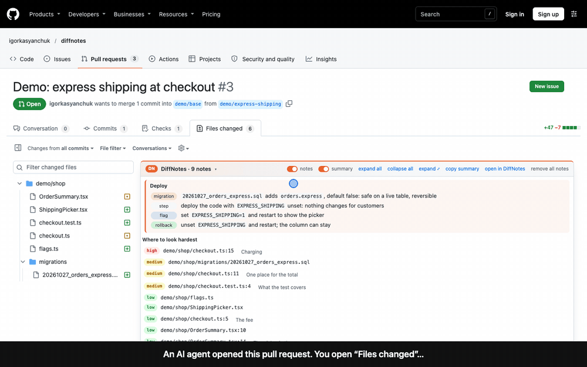
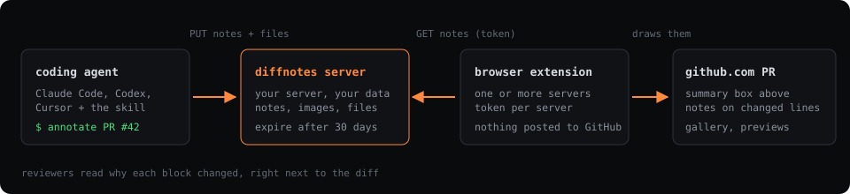
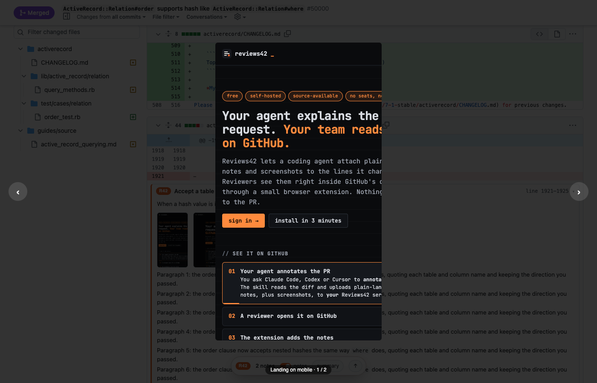
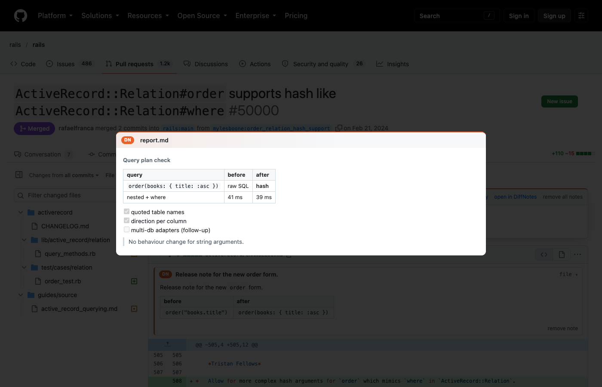
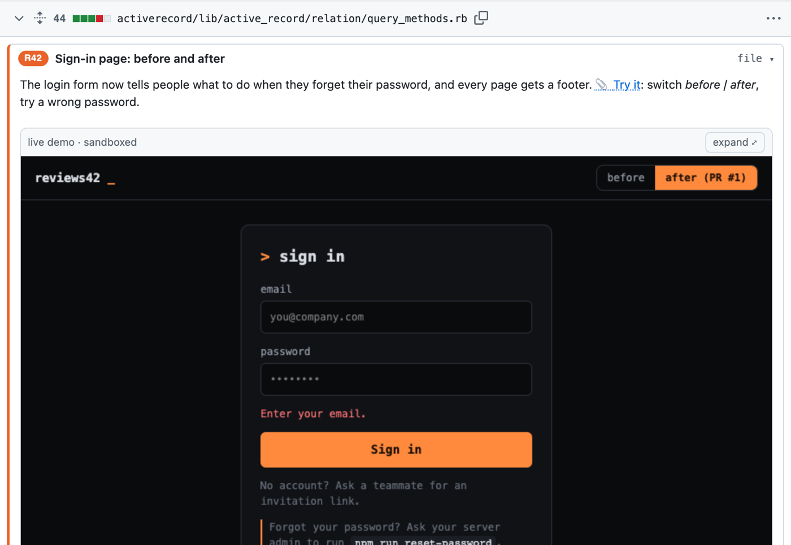
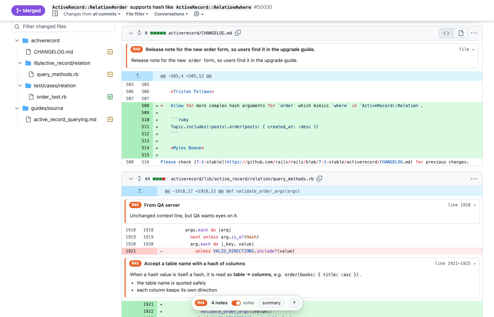
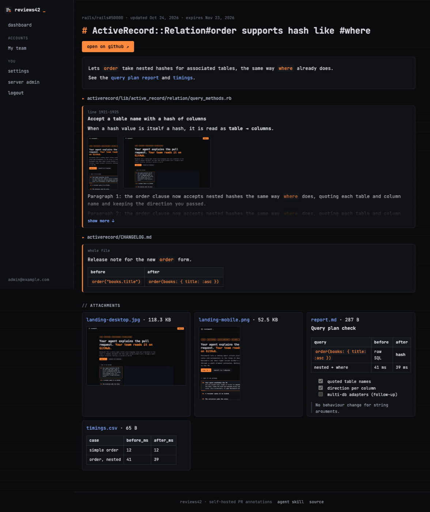

<p align="center"></p>

<h1 align="center">diffnotes</h1>

<p align="center"><b>Your coding agent explains the pull request. Your team reads it in the diff.</b><br>
Free · hosted at diffnotes.dev or self-hosted · open source (MIT) · GitHub, GitLab, Bitbucket</p>

<p align="center"><a href="https://diffnotes.dev"></a>
· <a href="https://diffnotes.dev/demo">live demo</a> · <a href="https://diffnotes.dev/badge">badge for your repo</a></p>

<p align="center"><a href="https://diffnotes.dev/demo"></a></p>

## TL;DR

- Your agent (Claude Code, Codex, Cursor…) **annotates a PR**: a plain-language “why” for each changed block, plus
  screenshots, short screen recordings, Markdown reports, CSVs and small interactive HTML demos. Through the skill or the MCP endpoint.
- The notes go to **a DiffNotes server**, never to GitHub, GitLab or Bitbucket: no bot comments, no notification noise. Use
  the free one at [diffnotes.dev](https://diffnotes.dev), or run your own and code context never leaves your infrastructure.
- Reviewers with the **browser extension** (Chrome, Edge, Brave, Arc) see them **inside the diff on GitHub, GitLab or Bitbucket**: a summary box on top, notes on the
  changed lines, image galleries, file previews, what changed since their last visit, one switch to hide everything.
- Notes **expire on their own** (after a year by default). Files on disk or in any S3-compatible bucket (Backblaze B2, R2, S3, MinIO).
- Up and running in **a few minutes**: a GitHub sign-in, one command for your agent, one extension (or one container of your own).

<p align="center"></p>

## Why

| | |
|---|---|
| **Review faster** | Reviewers read *why* a block changed before reading *how*. Fewer “what does this do?” round trips. |
| **Context from the author** | The agent that wrote the code explains it while it still knows the decisions and trade-offs. |
| **Screenshots in the diff** | UI changes come with before/after or mobile/desktop shots next to the lines that caused them. |
| **Zero noise** | Nothing is posted to the PR. The conversation stays for humans. |
| **Your data** | Self-hosted, invite-only (or sign-up with GitHub), per-account access. Code context never leaves your infrastructure. |
| **Any agent, any team** | One skill for every Agent Skills tool; one extension for several servers (teams, clients). |

## See it

| On GitHub | |
|---|---|
|  | **Summary box** above the files: the PR's summary, linked reports, a notes on/off switch, expand/collapse all. |
|  | **Gallery**: several images in one note (mobile + desktop), ← → to flip, Esc to close. |
|  | **Previews** of attached `.md`, `.csv` and `.txt` files, rendered in place. |
|  | **Live demos**: a small `.html` file runs in a locked sandbox under its note (no network, no access to GitHub); expand it at phone, tablet or desktop width. |
|  | **Floating dock** once you scroll: note count, notes switch, summary popover. Long notes get *show more / less*. |

| In the app | |
|---|---|
|  | Every annotated PR, with its notes and attachments. |
|  | **Accounts** with roles (owner, admin, member), invitations, repositories, storage per repository. |
|  | **Super admin**: users, accounts, uploads, disk, and where files are stored. |

## Install in 5 minutes

```bash
# 1. the server (any Docker host: a VPS, Coolify, Dokku…), or skip it and use https://diffnotes.dev
docker run -d -p 3000:3000 -v diffnotes:/data \
  -e ADMIN_EMAIL=you@company.com -e PUBLIC_URL=https://reviews.example.com ghcr.io/igorkasyanchuk/diffnotes
docker logs <container> | grep "first admin"        # the generated password
#    or: docker compose up -d (docker-compose.yml), or Render / Fly.io / Railway / Coolify: docs/deploy.md

# 2. the skill, on every developer machine (Claude Code, Codex, Cursor, other Agent Skills tools)
#    /welcome on your server gives the one command with a token in it (saved to ~/.config/diffnotes/env):
curl -fsSL https://reviews.example.com/install.sh | DIFFNOTES_SETUP_TOKEN=dn_… sh

# 3. the extension: https://chromewebstore.google.com/detail/fmnbgmeahjhfakpcmhimjjjplimdiibd
#    it opens a tab on install: your server's address → Sign in and connect → allow
```

Then ask your agent: **“annotate this PR with diffnotes”** and open the PR's *Files changed* tab. No skills in your agent?
Use the MCP endpoint instead: `claude mcp add --transport http diffnotes https://reviews.example.com/mcp --header "Authorization: Bearer $DIFFNOTES_TOKEN"` ([more](docs/skill.md#mcp-instead-of-the-skill)).

## Docs

| | |
|---|---|
| [Install & configure](docs/install.md) | Docker, environment variables, first admin, password reset, upgrades, backups |
| [Deploy](docs/deploy.md) | Docker Compose, Coolify, Render (one-click), Fly.io, Railway; one instance only |
| [Agent skill](docs/skill.md) | Install, token, how the agent writes notes, payload format, allowed files |
| [Browser extension](docs/extension.md) | Install (Chrome, Edge, Brave, Arc; Firefox and Safari as developer installs), several servers, GitHub / GitLab / Bitbucket, what you see, troubleshooting |
| [Accounts & roles](docs/accounts.md) | Owner / admin / member, invitations, repository rules, super admin, overview pages |
| [File storage](docs/storage.md) | Disk or S3-compatible (Backblaze B2, Cloudflare R2, AWS S3, MinIO), expiry |
| [Security](docs/security.md) | Access model, upload checks, sandboxing, tokens, secrets; report a vulnerability: [SECURITY.md](SECURITY.md) |
| [API](docs/api.md) | The HTTP API the skill and the extension use |
| [Development](AGENTS.md) | Stack, layout, commands, code rules |
| [Changelog](CHANGELOG.md) | What changed in each version; releases are tagged `vX.Y.Z` |
| [Privacy](https://diffnotes.dev/privacy) | What the extension and a server keep (every server also serves it at `/privacy`) |

## License

[MIT](LICENSE): use it, change it, host it, sell it; keep the copyright notice.
