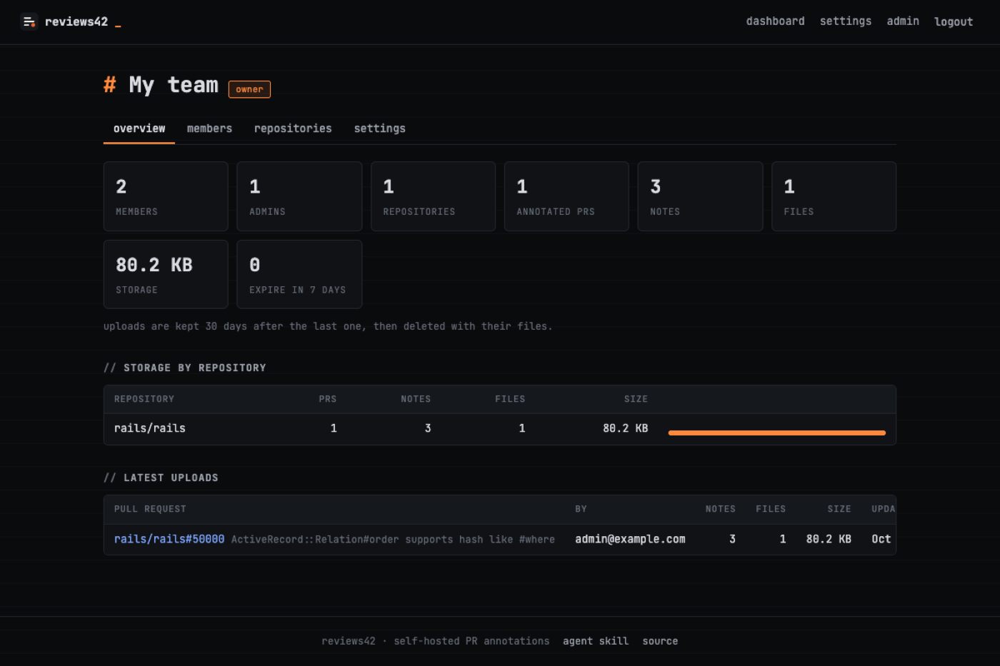
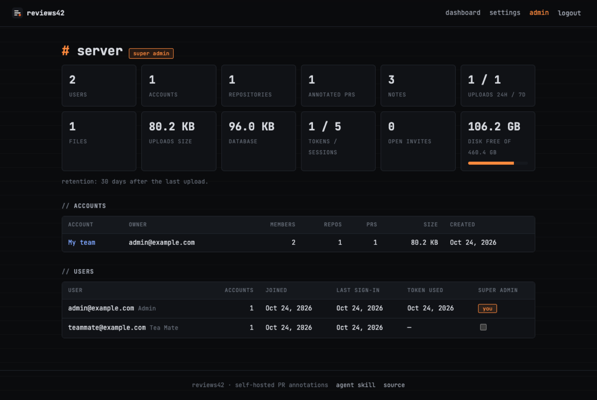

# Accounts & roles

← [README](../README.md)

DiffNotes is invite-only (unless [GitHub sign-up](#sign-in-with-github) is open). People belong to **accounts** (teams); repositories belong to one account, and everything about
a PR is visible only to members of the account that owns its repository. Anyone else gets `404`.

## Roles

| Role | Can |
|---|---|
| **owner** | everything an admin can, plus delete the account. One per account (who made it); can't be removed or demoted |
| **admin** | invite people (as admin or member), change roles, remove members, add and delete repositories, rename the account, remove any PR's notes |
| **member** | read the account's notes, upload notes with the skill (each upload replaces only their own), remove their own notes |

A repository is connected to an account on its first upload by an owner or admin (a member's first upload is refused
until an admin connects it), or added by an admin on the account's **repositories** tab: `owner/name` for GitHub, `host/path` for GitLab
and Bitbucket (`gitlab.com/group/project`, `bitbucket.org/team/app`), or just paste the repository's URL.

## Repository rules

Account → **repositories** → **rules** (owners and admins) sets what every upload to that repository must carry:

- **every note rates its risk** (`low`, `medium` or `high`), so the "where to look hardest" list is complete;
- **a deploy card**: migrations, env vars, feature flags, the order of steps, how to roll back (or "nothing special");
- **screenshots or a recording when a note touches** these paths: globs like `web/**`, `**/*.css`, `app/views/*`
  (`**` any folders, `*` within one name; `web/` means `web/**`), comma separated, 300 characters at most.

An upload that misses one is refused with `422` and a message saying what to add; the skill and MCP clients read it,
add it and upload again. The rules show as chips on the repository for everyone in the account. How notes are
*written* (language, tone, paths to skip) can live in the repository itself, in a
[`.diffnotes.yml`](skill.md#diffnotesyml) the skill follows.

## Deleting

- **A repository**: account → **repositories** → **delete** (admins). Its PRs, notes and uploaded files go with it.
- **An account**: account → **danger zone** → **delete account** (the owner), confirmed by typing its name. Every
  repository, note and file in it goes.
- **Your user**: **settings** → **danger zone** → **delete my user**, with your password and your email typed to confirm.
  Your tokens, sign-ins and memberships go, and so do the accounts you own with everything in them (the page lists them
  first). Notes you uploaded to other accounts stay. The last super admin can't delete themselves: make someone else
  super admin on `/admin` first.

There is no undo for any of these, and files are removed from disk or the bucket right away.

## Invitations

Account → **members** → email + role → **invite** → **copy link** and send it yourself: DiffNotes sends no emails. The link works for 7 days. New people
choose a name and password; people who already have a user enter their password to join. With GitHub sign-in on, they
can also **continue with GitHub** when the invited email is one of their GitHub account's verified emails. An email
invitation also waits on the dashboard of a user with that email once GitHub proved it is theirs (they signed in with
GitHub); a user whose email nobody proved gets it only through the link.

With GitHub sign-in on, invite a **GitHub login** instead of an email (`octocat` or `@octocat`): the invitation stays
pending until that login signs in with GitHub (which makes their user if they have none, even with sign-up closed),
then waits on their **dashboard** under *invitations for you* and they press **join**. Only a GitHub sign-in as that
login can accept it: the link alone (or a password) does not. A login belongs to whoever signed in with it last, since
GitHub logins can be renamed and taken.

**Open link**: under the invitations, pick how long it works (5, 10 or 30 minutes, 1 hour or 1 day) → **create link**
(copied right away). Anyone who has it joins as a **member** until it expires, any number of people: signed in already
(one click), with GitHub (which makes their user even with sign-up closed), or with the email and password of their
DiffNotes user. Without GitHub sign-in on the server, the form makes new users too; with it, new people come with GitHub,
since a typed email isn't proven and would let anyone holding the link claim an address and catch its invitations. Revoke it to stop it early. Handy for a meeting; don't post it anywhere public.

## Setup steps for new people

Joining through an invitation (or signing up with GitHub) lands on **/welcome**: three steps with a "start here" mark on
the current one — give your agent the skill, add the browser extension, annotate a first pull request. Each makes its
own token in place and ticks itself as it happens (the server sees the extension's first request, the agent's first
upload or MCP call, and the first uploaded notes; the extension says so with an `x-diffnotes-client: extension` header).
Until all three are done, the sidebar shows **setup n/3** and a bar on top offers to continue or hide it; "I've done
this" marks a step by hand in that browser (an extension older than 1.2 doesn't send the header). Existing users joining
another account see their steps already ticked, and so do users from before the steps who had used a token.

## Sign in with GitHub

Off unless the server has an OAuth app. On GitHub: Settings → Developer settings → **OAuth Apps** → **New OAuth App**,
homepage `https://reviews.example.com`, callback URL `https://reviews.example.com/auth/github/callback`; then
**Generate a new client secret** and set `GITHUB_CLIENT_ID` and `GITHUB_CLIENT_SECRET` ([install](install.md#environment)).

- The login page gets a **sign in with GitHub** button. It finds the user by their GitHub account, or by any of its
  verified emails. A user who has a password is linked on its first GitHub sign-in only after signing in with that
  password once (the login page asks), since an invitation never proved who owns the email; nothing else changes.
  A DiffNotes user already linked to another GitHub account is refused.
- Strangers are refused unless an invitation waits for one of their verified emails or their login, or `ALLOW_SIGNUP=1`: then anyone
  with a GitHub account gets a user and a team account they own (open registration; lower `MAX_ACCOUNT_MB` and
  `MAX_PULLS` to taste).
- A user made through GitHub has no password: they can set one on **Settings**, and delete themselves without one.

## Account overview

Account → **overview**: members, admins, repositories, annotated PRs, notes, files, storage, what expires within 7 days,
storage per repository, and the latest uploads with who uploaded them.

## Super admins

The first user (created on first boot) is a **super admin**: the person who runs the server. Super admins see
**server admin** (`/admin`): users, accounts, PRs, notes, uploads in the last 24 h / 7 days, files, upload and database
size, free disk; they can open and manage every account, make other users super admins, delete other users
(with the accounts they own; a super admin loses the flag first), and see where files are
stored ([storage](storage.md), set in the server's environment). In an account they are not a member of they see counts only, never PR titles, the
notes or files themselves (`404`), can't see or make invitations there, and they can still delete the account. Nobody can change their own super admin flag, so the server always keeps one.

