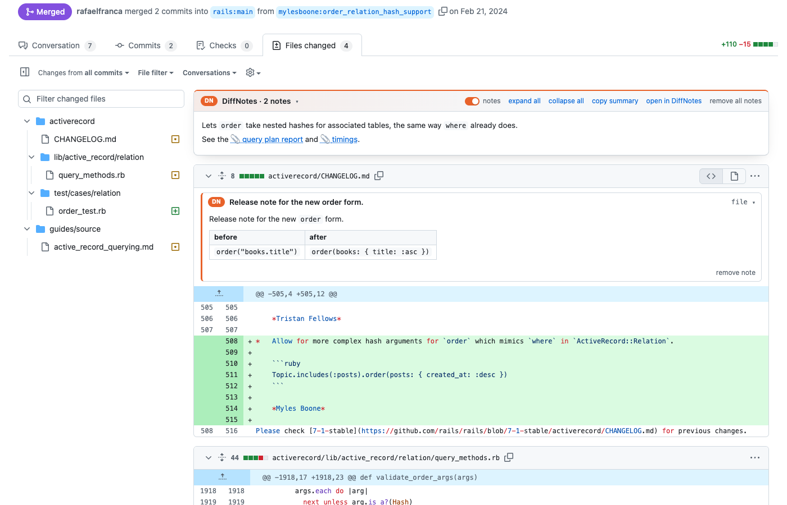
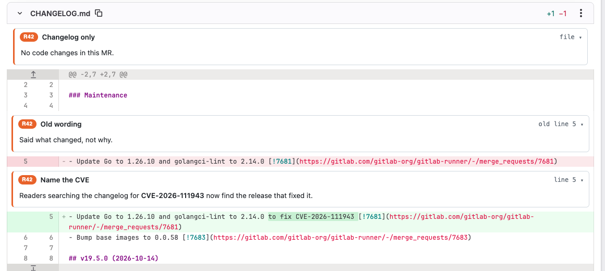
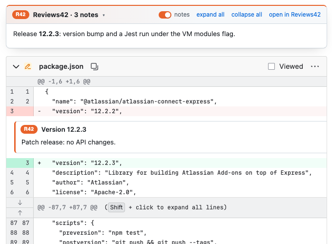

# Browser extension

← [README](../README.md)

The extension shows Reviews42 notes inside the pull request diff on **GitHub** (`/pull/<n>/changes`), **GitLab**
(`/-/merge_requests/<n>/diffs`, gitlab.com) and **Bitbucket Cloud** (`/pull-requests/<n>/diff`). It runs on
`github.com`, `gitlab.com` and `bitbucket.org` only and talks to the servers you connect; none of those sites ever see
the notes. Self-hosted GitLab: the server takes `gitlab.acme.dev/team/app` repositories already; the extension doesn't
run on your GitLab's host yet.

## Install (Chrome, Edge, Brave, Arc)

Until it is in the Chrome Web Store, load it from this repository:

1. Open `chrome://extensions` and switch on **Developer mode**.
2. **Load unpacked** → pick the `extension/` folder.
3. Pin **Reviews42**, open its popup, enter your server (`https://reviews.company.com`) and a token from the server's
   **Settings**, press **Connect** and allow access to that server.

After `git pull`, press the reload icon on the extension's card.

## Several servers

The popup lists every connected server with your email on it; add more with the same form (different teams, clients,
self-hosted and a colleague's server…). On a PR, all of them are asked: their notes show together, the toolbar badge
counts them all, and the summary box shows each server's summary under its name. Remove a server with **Remove**.

## What you see in the diff

Open a PR's **Files changed** tab:

| | |
|---|---|
| **Summary box** above the first file | the PR summary, linked reports, *notes* on/off switch, expand / collapse all, open in Reviews42 |
| **File cards** under file headers | notes about a whole file (new, renamed, deleted) |
| **Line notes** above changed blocks | the “why” for that block; click the header to collapse it |
| **Show more / less** | long notes are cut to a few lines |
| **Gallery** | click an image: every image of that note, ← → to move, Esc to close |
| **Previews** | links to attached `.md` / `.csv` / `.txt` open rendered in place |
| **Live demos** | an attached `.html` runs in a sandboxed frame under its note (no network, no access to GitHub); *expand* opens it at phone, tablet or desktop width |
| **Floating dock** | appears when the box scrolls away: note count, notes switch, summary popover, back to top |

Colors follow the site's light or dark theme. Notes whose line is not in the diff (a collapsed or not yet loaded file, or
a line that changed since) are listed in the summary box instead of being lost.

| GitLab merge request | Bitbucket pull request |
|---|---|
|  |  |

## Troubleshooting

| You see | Do |
|---|---|
| nothing at all | the PR has no notes on your servers, or you're not in the account that owns the repository |
| “can't reach …” in the box | open the popup and connect that server again (Chrome's permission for it is missing) |
| “… rejected the token” | the token was deleted: make a new one in Settings and reconnect |
| notes in the box, not in the diff | expand the file on the site, or the code moved since the notes were written: re-run the skill |
