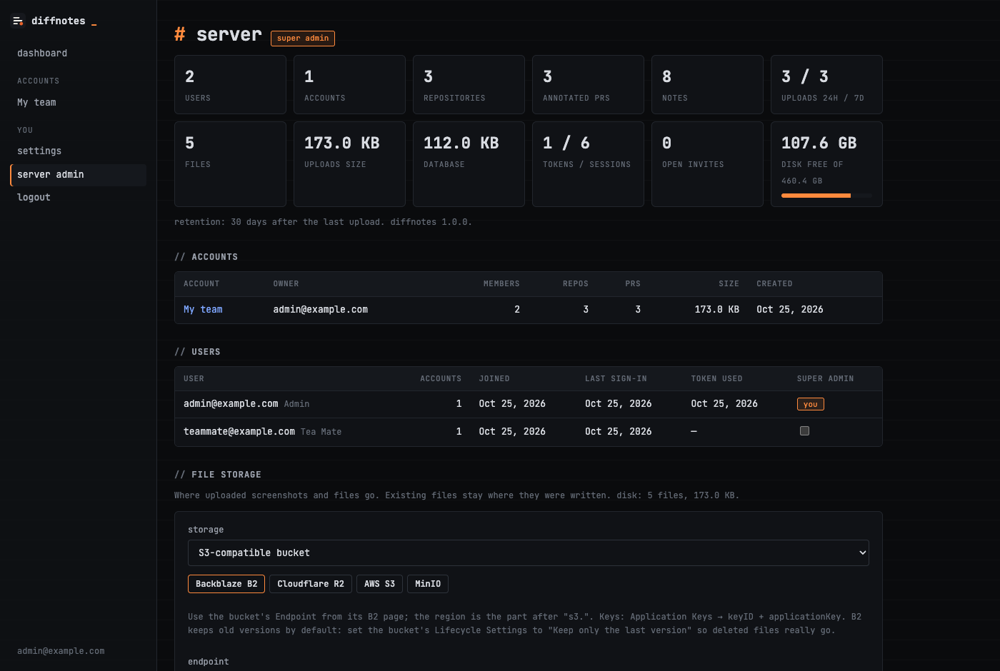

# File storage

← [README](../README.md)

Screenshots and files uploaded with notes are stored **on disk** (`DATA_DIR/uploads`, the default) or in an
**S3-compatible bucket**. A super admin chooses on **server admin → file storage**.

- Each file remembers where it was written, so switching never breaks older files; new uploads go to the new place.
  The bucket's endpoint, name and prefix can't change while files are still stored in it (they expire with their PRs).
- Files are always served through the server (`/files/…`), with the same access check as their PR. The bucket stays private.
- Quotas and statistics come from the database, so they work the same for both.

## S3-compatible providers

Pick a preset, fill in the bucket and keys, **save**. Saving writes, reads and deletes a test object first, so a wrong
endpoint or key never gets saved. The secret key is stored encrypted and never sent back to the browser.

| Provider | Endpoint | Region | Notes |
|---|---|---|---|
| **Backblaze B2** | `https://s3.<region>.backblazeb2.com` (the bucket's *Endpoint*) | e.g. `us-west-004` | Application Keys → keyID + applicationKey. Set the bucket's *Lifecycle Settings* to **Keep only the last version**: B2 keeps old versions by default, so deletes would only hide files. |
| **Cloudflare R2** | `https://<account-id>.r2.cloudflarestorage.com` | `auto` | R2 → Manage API tokens → Object Read & Write |
| **AWS S3** | `https://s3.<region>.amazonaws.com` | the bucket's region | IAM: `s3:PutObject`, `s3:GetObject`, `s3:DeleteObject`, `s3:PutLifecycleConfiguration` |
| **MinIO** | your MinIO URL | `us-east-1` | path-style URLs (MinIO's default) |

Objects are written as `<prefix>pulls/<pull id>/<file name>`, path-style, signed with AWS Signature V4.

## Expiry

Files expire with their PR, `RETENTION_DAYS` (30) after its last upload:

1. **The server deletes them**: an hourly job removes expired PRs and deletes their files from disk or from the bucket.
   Re-uploading a PR replaces the uploader's files right away.
2. **A bucket rule as a safety net**: **set the expiry rule on the bucket** adds a lifecycle rule that deletes everything
   under the prefix after `RETENTION_DAYS + 1` days (each re-upload writes new objects, so their age restarts). It
   replaces the bucket's existing lifecycle rules: use a bucket only for DiffNotes. Where the provider doesn't accept
   rules over the S3 API (Backblaze B2), set it in the provider's console instead.
